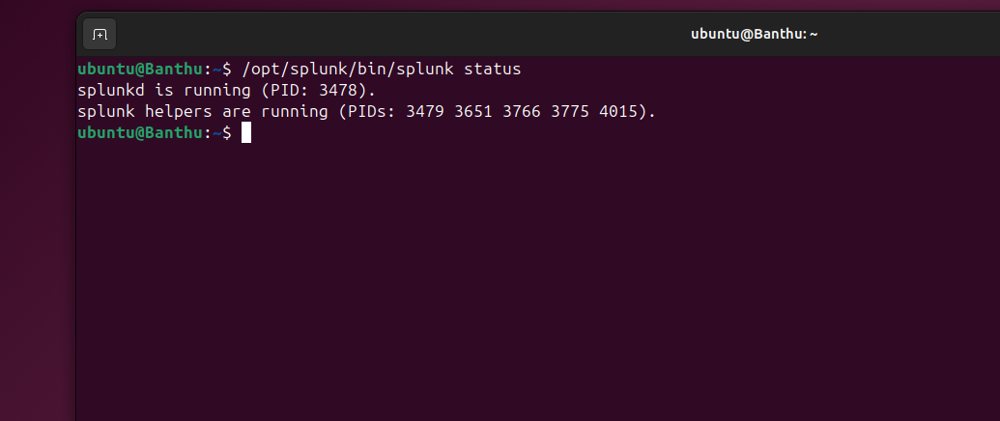
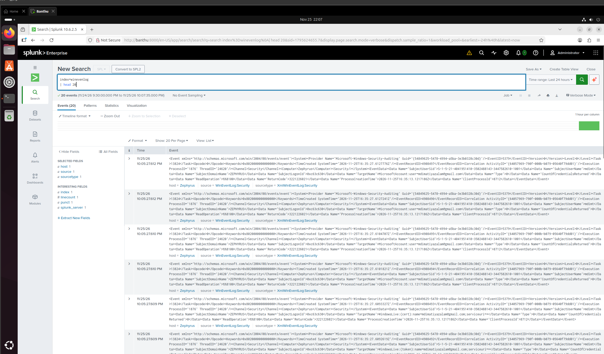
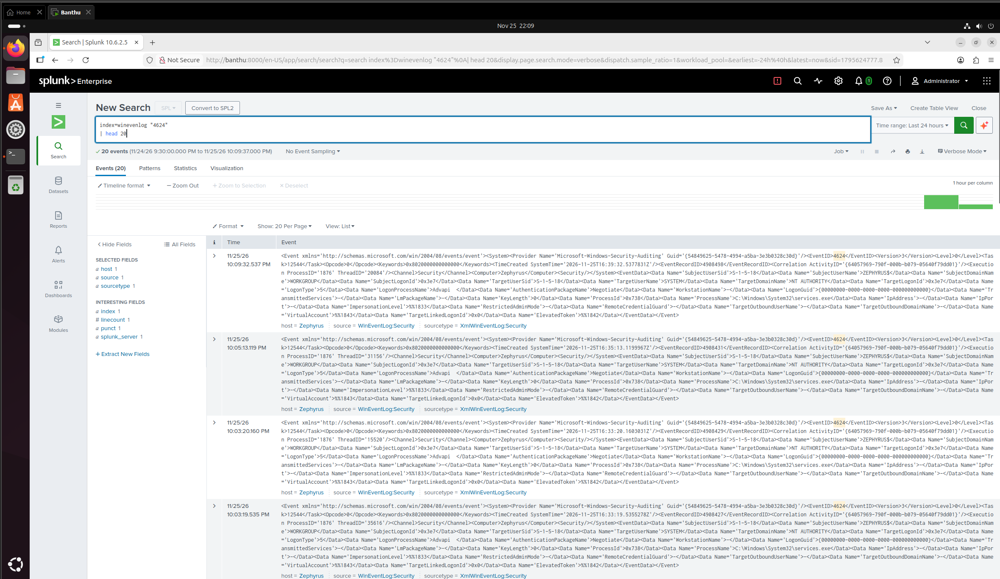
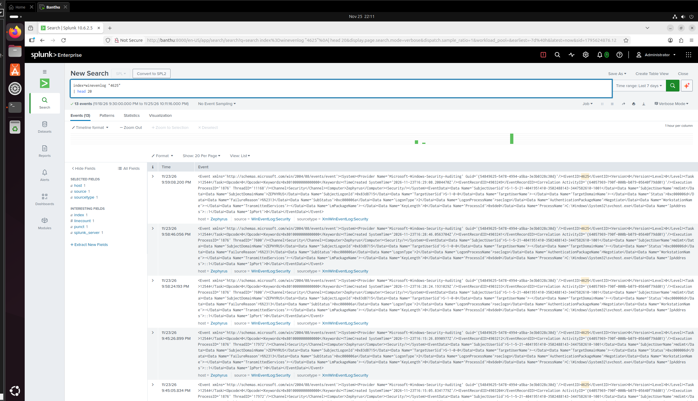
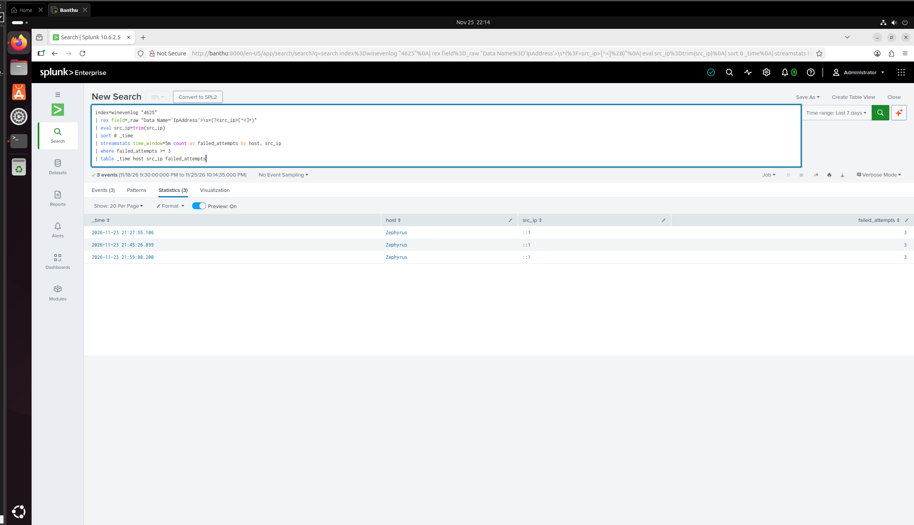
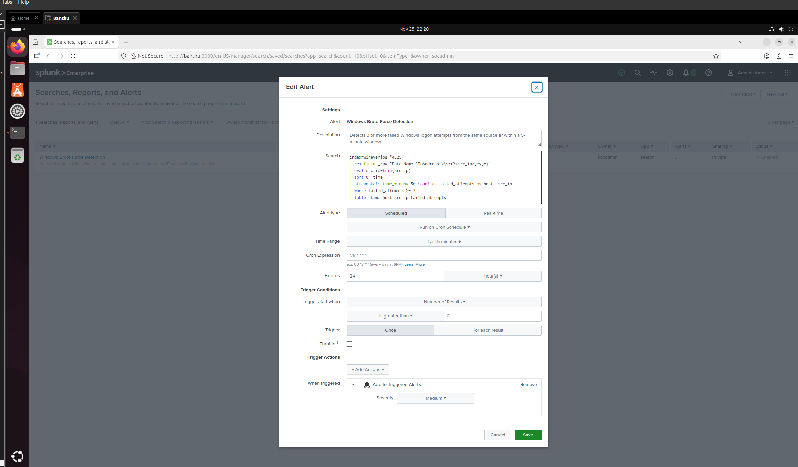
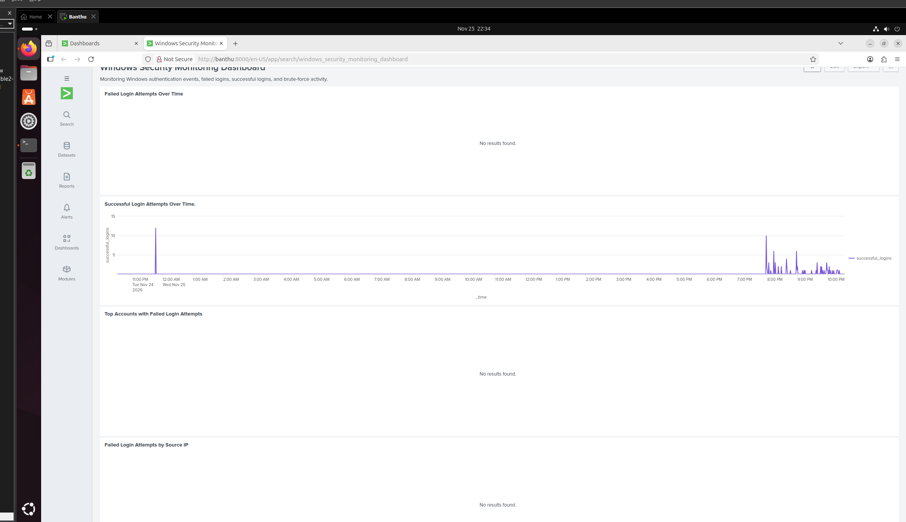

# Windows Authentication Monitoring and Brute-Force Detection Using Splunk

## About This Project

I built this project as a home lab to get some practical experience with Splunk and Windows Security logs.

The idea was to collect Windows login events in Splunk, understand what those events contain, and see how repeated failed login attempts can be detected.

I used my Windows machine to generate the logs and an Ubuntu virtual machine to run Splunk Enterprise. After setting up log forwarding, I worked on searching authentication events, creating a brute-force detection search, setting up an alert, and building a dashboard.

## Tools Used

- Splunk Enterprise
- Splunk Universal Forwarder
- Windows
- Ubuntu 24.04
- VMware Workstation
- Splunk Processing Language (SPL)

## Lab Setup

I used two machines for this project:

- **Windows:** Source of the Windows Security logs.
- **Ubuntu VM:** Runs Splunk Enterprise and receives the logs.

I installed Splunk Universal Forwarder on Windows and configured it to send Security event logs to my Splunk server over TCP port 9997.

I created an index in Splunk called `winevenlog` to store these events.

## What I Did

### 1. Set Up Windows Log Forwarding

I installed Splunk Universal Forwarder on my Windows machine and configured the Security log input.

This is the input configuration I used:

```ini
[WinEventLog://Security]
disabled = 0
index = winevenlog
renderXml = true
```

After starting the forwarder service, I checked Splunk and confirmed that Windows Security events were coming in.

### 2. Investigated Login Events

Once the logs started appearing in Splunk, I focused on two Windows Event IDs:

| Event ID | Meaning |
|---|---|
| 4624 | Successful login |
| 4625 | Failed login |

I searched for both event types and looked at the details recorded by Windows, such as account information, logon type, and source IP address.

### 3. Created a Brute-Force Detection Search

Next, I wanted to find repeated failed login attempts.

I created an SPL search that looks for three or more failed login events from the same host and source IP within a five-minute rolling window.

Here is the search I used:

```spl
index=winevenlog "4625"
| rex field=_raw "Data Name='IpAddress'>\s*(?<src_ip>[^<]+)"
| eval src_ip=trim(src_ip)
| sort 0 _time
| streamstats time_window=5m count as failed_attempts by host, src_ip
| where failed_attempts >= 3
| table _time host src_ip failed_attempts
```

I tested this by intentionally entering an incorrect password several times on my own Windows machine.

The search returned matching events and showed three or more failed attempts from `::1`, which is the IPv6 loopback address. This means the test activity came from the local machine.

### 4. Set Up a Scheduled Alert

After creating the detection search, I configured a scheduled alert in Splunk.

The alert is called **Windows Brute Force Detection**.

Its main settings are:

- Alert type: Scheduled
- Schedule: Every 5 minutes
- Time range: Last 5 minutes
- Condition: Number of results greater than 0
- Severity: Medium

The purpose of this alert is to notify me when the detection search finds repeated failed login attempts.

### 5. Created a Monitoring Dashboard

I also created a dashboard called **Windows Security Monitoring Dashboard**.

It contains four panels:

1. Failed Login Attempts Over Time
2. Successful Login Attempts Over Time
3. Failed Login Events by Subject Account
4. Failed Login Attempts by Source IP

The dashboard makes it easier to view authentication activity without running each search separately.

## What I Found

During the testing, I was able to:

- Forward Windows Security logs from Windows to Splunk.
- Find successful login events (4624).
- Find failed login events (4625).
- Detect repeated failed login attempts using SPL.
- Identify the local source address used during my test.
- Configure a scheduled alert and build a dashboard to monitor the activity.

All failed login attempts in this project were generated intentionally by me for testing. They were not part of a real attack.

## What I Learned

This project gave me practical experience with:

- Collecting Windows Security logs using Splunk Universal Forwarder.
- Searching and investigating authentication events.
- Understanding Windows Event IDs 4624 and 4625.
- Extracting fields from event data using `rex`.
- Using `stats`, `timechart`, and `streamstats` in SPL.
- Creating scheduled alerts and dashboards in Splunk.

## Project Status

Version 1 of this project is complete. I successfully configured Windows Security log forwarding to Splunk, investigated authentication events, created a brute-force detection search, configured a scheduled alert, and built a Windows security monitoring dashboard.

I plan to expand the project in the future by adding more detection rules and investigating additional security scenarios.

## Disclaimer

This project was carried out in my own home lab. All failed login attempts were generated intentionally for testing. No external systems or accounts were targeted.

## Screenshots

### 1. Splunk running


### 2. Windows Security Logs


### 3. Successful Login Events (4624)


### 4. Failed Login Events (4625)


### 5. Brute-Force Detection


### 6. Alert Configuration


### 7. Monitoring Dashboard

